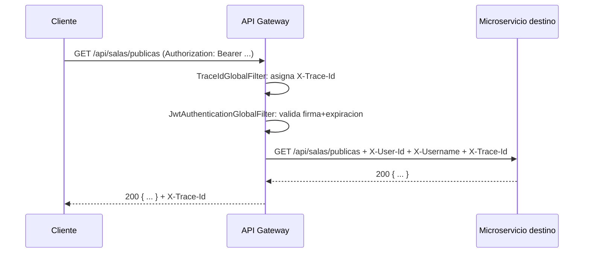

# API Gateway

> Puerta de entrada única del sistema: enrutamiento, validación de JWT y trazabilidad —
> lo primero que toca cada request REST de **UNO Power-Ups Arena**.

[]()
[]()
[]()
[]()

---

## Tabla de contenidos

1. [Descripción](#1-descripción)
2. [Arquitectura](#2-arquitectura)
3. [Tecnologías](#3-tecnologías)
4. [Requisitos](#4-requisitos)
5. [Instalación](#5-instalación)
6. [Configuración](#6-configuración)
7. [Ejecución](#7-ejecución)
8. [Estructura del proyecto](#8-estructura-del-proyecto)
9. [Flujo interno](#9-flujo-interno)
10. [Rutas / API](#10-rutas--api)
11. [Seguridad](#11-seguridad)
12. [Logs y trazabilidad](#12-logs-y-trazabilidad)
13. [Observabilidad](#13-observabilidad)
14. [Testing](#14-testing)
15. [Despliegue](#15-despliegue)
16. [Solución de problemas](#16-solución-de-problemas)
17. [Roadmap](#17-roadmap)
18. [Contribución](#18-contribución)
19. [Licencia](#19-licencia)
20. [Autor](#20-autor)

---

## 1. Descripción

**API Gateway** es el único punto de entrada REST del sistema. No implementa lógica de negocio:
enruta cada request al microservicio correspondiente, valida el JWT una sola vez (para que los
servicios de negocio no dupliquen esa lógica), y añade un `X-Trace-Id` para poder correlacionar
logs entre servicios de una misma petición.

**No** enruta el WebSocket de partida — ese tráfico va directo a
[Game Service](../GameService) por razones de latencia (ver EC-01, documentado en detalle en el
propio README de Game Service).

### Responsabilidades exactas

| Responsabilidad | Cómo |
|---|---|
| Enrutar `/api/**` al microservicio correcto | Predicados `Path=` de Spring Cloud Gateway |
| Validar JWT antes de que la petición llegue al backend | `JwtAuthenticationGlobalFilter` |
| Propagar identidad ya verificada | Headers `X-User-Id` / `X-Username` agregados tras validar |
| Generar/propagar ID de correlación (HU-10) | `TraceIdGlobalFilter` → header `X-Trace-Id` |
| CORS centralizado (una sola configuración para todo el sistema) | `spring.cloud.gateway.globalcors` |
| Cabeceras de seguridad básicas en toda respuesta | `default-filters` (`X-Content-Type-Options`, `X-Frame-Options`, `Referrer-Policy`) |

---

## 2. Arquitectura

```
                         ┌─────────────────────────────────────────┐
   Internet ───HTTPS────▶│              API Gateway :8080           │
                         │  TraceIdGlobalFilter (order -2)           │
                         │  JwtAuthenticationGlobalFilter (order -1) │
                         └───────────────┬───────────┬──────────────┘
                       Path=/api/usuarios/**   Path=/api/salas/**   Path=/api/partidas/**
                                 │                    │                     │
                                 ▼                    ▼                     ▼
                          User Service          Lobby Service         Game Service
                             :8081                 :8082                 :8083
```

Orden de ejecución de los filtros globales (`Ordered`, menor número = ejecuta primero):

1. `TraceIdGlobalFilter` (`order = -2`) — asigna/propaga `X-Trace-Id` y loguea la request.
2. `JwtAuthenticationGlobalFilter` (`order = -1`) — valida el token y agrega `X-User-Id`/`X-Username`.
3. Enrutamiento hacia el microservicio (`RouteLocator` reactivo de Spring Cloud Gateway).

---

## 3. Tecnologías

| Tecnología | Versión | Uso |
|---|---|---|
| Java | 21 | Lenguaje |
| Spring Boot | 3.2.5 | Framework base |
| Spring Cloud Gateway | 2023.0.1 (BOM `spring-cloud-dependencies`) | Enrutamiento reactivo, CORS, filtros globales |
| jjwt | 0.12.6 | Verificación de la firma HS512 del JWT |
| Spring Boot Actuator + Micrometer | incluido en Boot 3.2.5 | Health, métricas Prometheus |
| Logstash Logback Encoder | 7.4 | Logs JSON estructurados con `traceId` |
| Reactor Test + JUnit 5 | incluido en Boot 3.2.5 | Testing reactivo del filtro JWT |
| JaCoCo | 0.8.12 | Cobertura de tests |
| Maven | 3.9+ | Build |
| Docker | multi-stage | Empaquetado |

---

## 4. Requisitos

- **Java 21**.
- **Maven 3.9+**.
- Los 3 microservicios de negocio deben ser alcanzables en red (no necesitan estar arriba para
  que el Gateway arranque, solo para que las rutas respondan).
- **Docker** (opcional).

---

## 5. Instalación

```bash
git clone https://github.com/UNO-POWER/APIGATEWAY.git
cd APIGATEWAY
java -version
mvn -q -DskipTests package
mvn test
```

---

## 6. Configuración

| Variable | Obligatoria en prod | Valor por defecto (dev) | Descripción |
|---|---|---|---|
| `JWT_SECRET` | ✅ | secreto de ejemplo | Debe ser **idéntico** al de User Service y Game Service |
| `JWT_EXPIRATION_MS` | ❌ | `86400000` (24h) | Solo informativo aquí (la expiración real la fija User Service al emitir el token); el Gateway solo valida que no haya expirado |
| `USER_SERVICE_URL` | ✅ | `http://localhost:8081` | Destino de `/api/usuarios/**` |
| `LOBBY_SERVICE_URL` | ✅ | `http://localhost:8082` | Destino de `/api/salas/**` |
| `GAME_SERVICE_URL` | ✅ | `http://localhost:8083` | Destino de `/api/partidas/**` |
| `CORS_ALLOWED_ORIGINS` | ✅ | `http://localhost:5173` | Único origen (o lista) permitido — **nunca** `*` |
| `SERVER_PORT` | ❌ | `8080` | Puerto HTTP |

---

## 7. Ejecución

### Desarrollo

```bash
JWT_SECRET="un-secreto-largo-compartido-con-userservice-y-gameservice" \
USER_SERVICE_URL="http://localhost:8081" \
LOBBY_SERVICE_URL="http://localhost:8082" \
GAME_SERVICE_URL="http://localhost:8083" \
CORS_ALLOWED_ORIGINS="http://localhost:5173" \
mvn spring-boot:run
```

```bash
curl http://localhost:8080/actuator/health
```

### Producción (JAR)

```bash
mvn -q -DskipTests package
java -jar target/apigateway-0.1.0.jar
```

### Docker / Docker Compose

```bash
docker build -t uno-api-gateway .
docker compose up -d --build api-gateway
```

---

## 8. Estructura del proyecto

```
APIGATEWAY/
├── src/main/java/com/unopower/apigateway/
│   ├── ApiGatewayApplication.java
│   ├── config/
│   │   ├── GatewayConfig.java   # habilita JwtProperties como @ConfigurationProperties
│   │   └── JwtProperties.java   # binding de jwt.secret / jwt.expiration-ms
│   └── filter/
│       ├── TraceIdGlobalFilter.java          # order -2: X-Trace-Id
│       └── JwtAuthenticationGlobalFilter.java # order -1: valida JWT, agrega X-User-Id/X-Username
├── src/main/resources/
│   ├── application.yml   # rutas, CORS, default-filters, jwt
│   └── logback-spring.xml
├── src/test/java/…/filter/
│   └── JwtAuthenticationGlobalFilterTest.java   # 4 tests
├── Dockerfile
└── pom.xml
```

No hay `controller/` ni `service/`: Spring Cloud Gateway enruta declarativamente vía
`application.yml`, no hay lógica de negocio propia que justifique esas capas.

---

## 9. Flujo interno

1. **`TraceIdGlobalFilter`** revisa si la request ya trae `X-Trace-Id` (por ejemplo, reenviada
   desde otro sistema); si no, genera un `UUID` nuevo. Lo agrega tanto al request mutado (para que
   los servicios de negocio lo reciban) como a la respuesta (para que el cliente pueda
   correlacionar). También lo pone en el MDC de SLF4J durante el log de la request, así ese log
   sale con `traceId` en el JSON.
2. **`JwtAuthenticationGlobalFilter`** revisa el path contra una lista de rutas públicas
   (`/api/usuarios/registro`, `/login`, `/guest`, y todo `/actuator`). Si es pública, pasa directo.
   Si no, exige `Authorization: Bearer <token>`, lo verifica con la clave HS512 compartida, extrae
   `sub` (userId) y el claim `username`, y los agrega como headers `X-User-Id`/`X-Username` **antes**
   de reenviar la request al microservicio destino. Si el token falta o es inválido, corta con
   `401` sin llegar a tocar ningún backend.
3. **Enrutamiento**: Spring Cloud Gateway compara el path contra los predicados `Path=` definidos
   en `application.yml` y reenvía (proxy reactivo) al `uri` configurado para esa ruta.



---

## 10. Rutas / API

El Gateway no define endpoints propios de negocio — reenvía. La documentación completa de cada
endpoint (método, body, respuesta, errores) vive en el README de cada servicio de destino.

| Predicado | Destino (env var) | Documentado en |
|---|---|---|
| `Path=/api/usuarios/**` | `USER_SERVICE_URL` | [`UserService/README.md`](../UserService/README.md#10-api) |
| `Path=/api/salas/**` | `LOBBY_SERVICE_URL` | [`LobbyService/README.md`](../LobbyService/README.md#10-api) |
| `Path=/api/partidas/**` | `GAME_SERVICE_URL` | [`GameService/README.md`](../GameService/README.md#10-api-rest-interna) — nota: la API de juego real es por WebSocket, no REST; este predicado existe por si se agregan endpoints REST auxiliares a futuro |

### Rutas públicas (sin JWT)

```
POST /api/usuarios/registro
POST /api/usuarios/login
POST /api/usuarios/guest
GET  /actuator/**  (todos los sub-paths de Actuator)
```

Cualquier otro path bajo `/api/**` requiere `Authorization: Bearer <token>` válido.

### Respuesta de error propia del Gateway

Si el JWT falta o es inválido, el Gateway responde **sin reenviar la petición**:

```
HTTP/1.1 401 Unauthorized
X-Auth-Rejected-Reason: falta encabezado Authorization Bearer
```
(o `token invalido o expirado` según el caso)

---

## 11. Seguridad

- **Único punto de validación de JWT para tráfico REST** — los servicios de negocio (User, Lobby)
  confían ciegamente en `X-User-Id`/`X-Username` porque asumen que llegaron a través de este
  Gateway; por eso, en despliegue, esos servicios **no deben** exponer su puerto directamente a
  Internet (ver `deploy/docker-compose.prod.yml`, sin `ports:` publicados para ellos).
- **CORS explícito**, nunca `*` — solo el/los orígenes configurados en `CORS_ALLOWED_ORIGINS`
  pueden hacer requests cross-origin, y solo con métodos `GET`/`POST`/`OPTIONS` y headers
  `Authorization`/`Content-Type`.
- **Cabeceras de seguridad en toda respuesta** (`default-filters`): `X-Content-Type-Options: nosniff`,
  `X-Frame-Options: DENY`, `Referrer-Policy: no-referrer`.
- **Rutas públicas explícitamente listadas** (allowlist), no una regla negativa — reduce el riesgo
  de dejar sin querer una ruta sensible sin protección.

---

## 12. Logs y trazabilidad

Logs JSON estructurados vía Logstash Logback Encoder, con `traceId` inyectado por MDC durante el
procesamiento de cada request:

```json
{
  "@timestamp": "2026-07-08T20:41:02.331Z",
  "message": "request path=/api/salas/publicas method=GET",
  "logger_name": "com.unopower.apigateway.filter.TraceIdGlobalFilter",
  "level": "INFO",
  "traceId": "3f9e2b6a-9c1a-4e9d-8b1a-2f7b1c9a0e21",
  "service": "api-gateway"
}
```

El mismo `X-Trace-Id` viaja en los headers hacia el microservicio destino, que lo puede incluir en
sus propios logs — así una request completa se puede seguir end-to-end en los 3 servicios
filtrando por ese único valor (HU-10).

---

## 13. Observabilidad

- `GET /actuator/health` — estado del Gateway (no verifica la salud de los servicios destino).
- `GET /actuator/prometheus` — scrapeado por Prometheus (job `api-gateway`, cada 5s). Expone
  métricas técnicas estándar (latencia por ruta, conteo de requests, JVM) vía Micrometer; no
  define métricas de negocio propias (esas viven en Game Service, ver HU-11).

---

## 14. Testing

```bash
mvn test
mvn test jacoco:report   # target/site/jacoco/index.html
```

**4 tests** (JUnit 5 + Reactor Test) en `JwtAuthenticationGlobalFilterTest`:

| Caso | Resultado esperado |
|---|---|
| Ruta pública (`/api/usuarios/login`) sin token | Pasa sin validar, llega al filtro siguiente |
| Ruta protegida sin header `Authorization` | `401` con `X-Auth-Rejected-Reason` |
| Ruta protegida con token inválido/mal formado | `401` |
| Ruta protegida con token válido | Pasa, con `X-User-Id`/`X-Username` agregados a la request mutada |

---

## 15. Despliegue

- **Docker**: `Dockerfile` multi-stage (Maven → JRE Alpine).
- **Docker Compose**: servicio `api-gateway` en [`docker-compose.yml`](../docker-compose.yml) (dev)
  y en [`deploy/docker-compose.prod.yml`](../deploy/docker-compose.prod.yml) (producción, único
  servicio backend con puerto expuesto además de Game Service para el WebSocket).
- **AWS**: en producción, el proxy `nginx` de borde reenvía `/api/**` hacia este servicio bajo el
  mismo dominio HTTPS que el frontend — ver [`deploy/DEPLOY.md`](../deploy/DEPLOY.md).

---

## 16. Solución de problemas

| Síntoma | Causa probable | Solución |
|---|---|---|
| `401` en toda request, incluso con token recién emitido | `JWT_SECRET` distinto entre Gateway y User Service | Verificar que las 3 variables `JWT_SECRET` (Gateway, User, Game) sean idénticas |
| CORS bloqueado en el navegador | El origen del frontend no está en `CORS_ALLOWED_ORIGINS` | Agregar el origen exacto (protocolo + dominio + puerto) a la variable |
| `502`/`503` al llamar una ruta | El microservicio destino está caído o la URL de env var es incorrecta | Verificar `curl $SERVICE_URL/actuator/health` directamente contra ese servicio |
| Los logs de 3 servicios no correlacionan | El cliente no reenvía `X-Trace-Id`, o algún servicio no lo propaga a sus propios logs | Confirmar que el header viaja en la respuesta y que cada servicio lo agrega al MDC |

---

## 17. Roadmap

- Rate limiting por IP/usuario (actualmente no implementado — fuera de alcance del Inception doc
  original, propuesto como mejora de resiliencia).
- Circuit breaker hacia los servicios destino (Resilience4j) para degradar con gracia si uno cae.
- Documentación OpenAPI agregada (agregación de los specs de cada microservicio).

---

## 18. Contribución

1. Cualquier ruta nueva se agrega en `application.yml`, no en código Java.
2. Si una ruta nueva debe ser pública, agregar el prefijo exacto a `PUBLIC_PATHS` en
   `JwtAuthenticationGlobalFilter` — revisar con cuidado, es la única barrera de autenticación
   del sistema para tráfico REST.
3. Tests obligatorios (`JwtAuthenticationGlobalFilterTest`) para cualquier cambio en la lógica de
   validación o en las rutas públicas.
4. `mvn test` antes de abrir PR.
5. Commits en [Conventional Commits](https://www.conventionalcommits.org/).

---

## 19. Licencia

MIT — ver [`LICENSE`](../LICENSE) en el repositorio raíz.

---

## 20. Autor

**DUCU** — Desarrollador Full-Stack (individual), proyecto de la asignatura ARSW.
Organización GitHub: [UNO-POWER](https://github.com/UNO-POWER).

Repositorio raíz del sistema: **[UNO Power-Ups Arena](../README.md)**.
